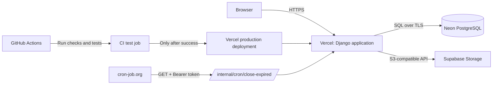
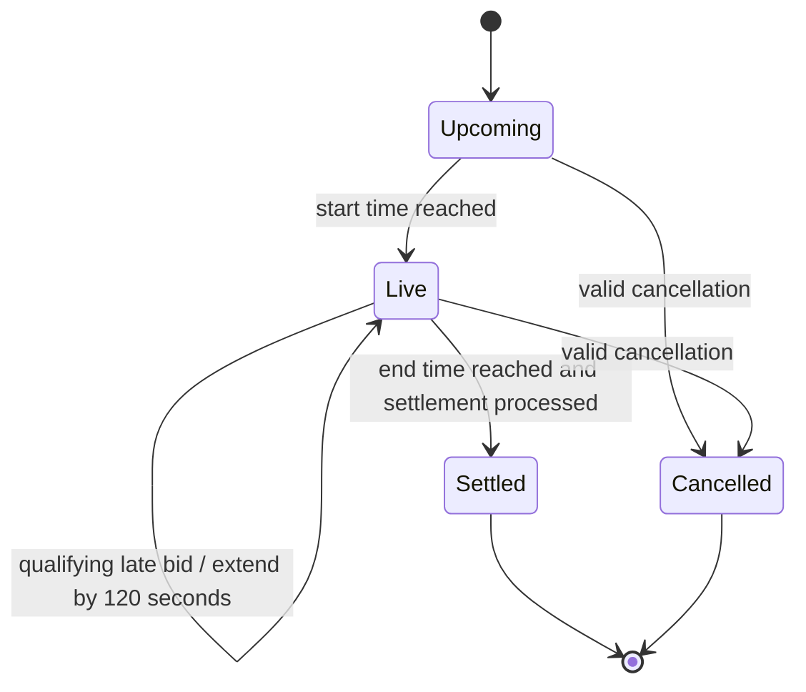

# BidSphere

**A Django auction marketplace built around proxy bidding, virtual-credit accounting, and scheduled settlement.**

[](https://github.com/Siddharthsharmasj/BidSphere/actions/workflows/ci-cd.yml)


[Live application](https://bidsphere-eight.vercel.app/) · [Source code](https://github.com/Siddharthsharmasj/BidSphere) · [CI/CD runs](https://github.com/Siddharthsharmasj/BidSphere/actions)

BidSphere is a full-stack auction simulator. Users can list items, schedule auctions, submit maximum proxy bids, track bid activity, and review how virtual credits move through bidding and settlement. It uses virtual credits only; it does not process real-money payments.

## Product preview


The deployed interface is the source of truth for the current product experience. The diagrams below describe the main flows and deployment components.

## What it does

- **Auction listings:** Create listings with a category, image, starting price, minimum increment, start time, and end time.
- **Scheduled auction states:** Track upcoming, live, ended, and cancelled auctions.
- **Proxy bidding:** A bidder supplies a maximum amount; the visible price advances according to the auction's bidding rules rather than jumping directly to every bidder's maximum.
- **Anti-sniping:** A qualifying bid in the final 120 seconds extends the end time by 120 seconds, giving other bidders time to respond.
- **Virtual wallet:** Track available credits, reserved bidding amounts, refunds, and final settlement transactions.
- **Bid history and watchlists:** Follow auction activity and save items of interest.
- **Notifications and seller tools:** The project also includes notification, seller analytics, and reporting/moderation functionality.
- **Administration and APIs:** Django admin and the project's REST API support management and programmatic access. The codebase also includes Django Channels/WebSocket components; deployment-specific behavior should be verified in the target environment.
- **Automated settlement:** A protected endpoint lets a scheduled request ask Django to process expired auctions without waiting for a user to open the site.

## System architecture



### Main components

| Component | Responsibility |
| --- | --- |
| Django | Request handling, authentication, auction rules, bidding, wallet accounting, and settlement logic |
| Neon PostgreSQL | Persistent application records, bids, auctions, and wallet transaction data |
| Supabase Storage | Persistent uploaded images; the application uses its S3-compatible interface |
| Vercel | Hosts the Django application |
| GitHub Actions | Runs validation, Django checks, PostgreSQL-backed tests, migration checks, and dependency auditing before deployment |
| cron-job.org | Calls the protected expired-auction endpoint on a recurring schedule |

## Auction lifecycle



Settlement is a separate operation from merely reaching the end time. The scheduled job prompts the application to process eligible expired auctions; it should not be treated as a guarantee of execution at the exact second an auction expires.

## How proxy bidding and wallet reservations work

Each new user starts with **100,000 virtual credits** in the documented default setup. `Profile.virtual_credits` represents the available/spendable balance. When a maximum proxy bid is accepted, the maximum amount is reserved; it is not necessarily the final amount the winner pays.

The intended accounting flow is:

1. Validate the auction state, bidder, bid limits, and available balance.
2. Reserve the bidder's maximum amount and calculate the visible bid.
3. If another bidder becomes the leader, release the previous leader's reservation as appropriate.
4. When the auction is settled, credit the seller with the final visible price and return the winner's unused reservation.
5. Record wallet movements in `WalletTransaction` so the balance changes can be inspected.

### Example

This example illustrates the documented reservation model; amounts are virtual credits.

| Event | Bidder A | Bidder B | Visible bid |
| --- | ---: | ---: | ---: |
| Starting price | — | — | 100 |
| A sets maximum 300 | 300 reserved | — | 100 |
| B sets maximum 500 and overtakes A | A's 300 reservation is released | 500 reserved | 310 |
| Auction settles | — | Pays 310 net; 190 unused credits returned | 310 |

Bid and wallet updates are designed to run transactionally, using database locking to reduce the chance of inconsistent results when requests overlap. The test suite should remain the source of truth for the exact boundary cases and supported invariants.

## Run locally

### Prerequisites

- Python 3.12
- Git
- A database configuration suitable for local development

### Setup on Windows PowerShell

```powershell
git clone https://github.com/Siddharthsharmasj/BidSphere.git
cd BidSphere
py -3.12 -m venv .venv
.\.venv\Scripts\python.exe -m pip install --upgrade pip
.\.venv\Scripts\python.exe -m pip install -r requirements.txt
```

Review `.env.example` and configure local-only environment values for your setup. Do not copy production secrets into local files and never commit `.env` files. If PowerShell blocks the activation script, use the `.venv\Scripts\python.exe` form shown above rather than changing the machine-wide execution policy.

Apply migrations and create an administrator account:

```powershell
.\.venv\Scripts\python.exe manage.py migrate
.\.venv\Scripts\python.exe manage.py createsuperuser
.\.venv\Scripts\python.exe manage.py runserver
```

Open `http://127.0.0.1:8000/` in a browser.

### Optional development commands

Seed a local/demo database:

```powershell
.\.venv\Scripts\python.exe manage.py seed_demo --reset
```

> **Warning:** `seed_demo --reset` is for a disposable local/demo database only. Never run it against production; it can reset demo data.

Settle expired auctions manually during local development:

```powershell
.\.venv\Scripts\python.exe manage.py close_expired
```

Audit wallet balances and ledger records:

```powershell
.\.venv\Scripts\python.exe manage.py audit_wallets
```

## API surface

The project README documents these auction endpoints:

| Method | Endpoint | Purpose |
| --- | --- | --- |
| `GET` | `/api/auctions/` | List auctions |
| `GET` | `/api/auctions/<id>/` | Retrieve an auction |
| `GET` | `/api/auctions/<id>/bids/` | Retrieve bid history |
| `POST` | `/api/auctions/<id>/bid/` | Submit a maximum bid; requires an authenticated session |

Example request body for a bid:

```json
{
  "max_amount": 25000
}
```

Refer to the view/URL definitions for the full current contract, validation rules, and response schemas before building a client against these routes.

## Testing and CI/CD

The workflow at `.github/workflows/ci-cd.yml` runs on pushes and pull requests targeting `main`. It includes:

- Python 3.12 setup and dependency installation
- `pip check` and project structure/syntax validation
- Django configuration and deployment-security checks
- Static asset collection
- Migration consistency check (`makemigrations --check --dry-run`)
- Django tests against a PostgreSQL service
- `pip-audit` dependency auditing

When `ENABLE_VERCEL_DEPLOY` is set to `true`, the workflow's deployment jobs run only after the test job succeeds. Production deployment is gated to pushes to `main`; preview deployment is gated to pull requests from this repository. Vercel performs the deployment build remotely.

Current workflow status: [view GitHub Actions](https://github.com/Siddharthsharmasj/BidSphere/actions).

## Production configuration

The deployed application uses separate services for the web process, relational data, uploaded images, and scheduled settlement.

| Configuration | Purpose |
| --- | --- |
| `DJANGO_SECRET_KEY` | Django signing and security secret |
| `DJANGO_DEBUG` | Must be disabled in production |
| `DATABASE_URL` | PostgreSQL connection string for Neon |
| `CRON_SECRET` | Bearer token protecting the expired-auction endpoint |
| `DJANGO_SECURE_HSTS_SECONDS` | HSTS duration |
| `AWS_STORAGE_BUCKET_NAME` | Supabase Storage bucket name (`bidsphere-media`) |
| `AWS_ACCESS_KEY_ID` / `AWS_SECRET_ACCESS_KEY` | Server-side S3-compatible access credentials |
| `AWS_S3_ENDPOINT_URL` / `AWS_S3_REGION_NAME` | Supabase S3 endpoint and region |
| `AWS_S3_CUSTOM_DOMAIN` | Public base URL used to serve bucket images |

Set these values in the hosting provider's environment-variable settings, not in source control. The S3-compatible secret key has access to storage resources; never expose it to client-side code. Only use a public bucket for images intended to be publicly viewable.

### Scheduled settlement

The deployment uses the protected endpoint:

```text
GET /internal/cron/close-expired/
Authorization: Bearer <CRON_SECRET>
```

The configured scheduler calls it periodically. The endpoint returns a JSON summary such as `checked`, `settled`, and `failed`. Monitor both the HTTP status and the response body; a successful HTTP response alone is not enough to prove that every settlement succeeded.

## Security notes

- This project uses virtual credits and is an auction simulator; it is not a real-money payment system.
- Never commit `.env`, `.env.local`, `.vercel`, database URLs, S3 credentials, Vercel tokens, or Django/cron secrets.
- Use different secrets for local development and production. Rotate any credential that was accidentally exposed.
- Never run demo-reset commands against production data.
- Test settlement, cancellation, refunds, and concurrent bidding before opening the application to a wider audience.

## Repository layout

```text
.
├── auction/                 # Auction, bidding, wallet, and related app code
├── bidsphere/               # Django project configuration and URL routing
├── docs/screenshots/        # Product screenshots used in documentation
├── .env.example             # Local environment template
├── .env.vercel.example      # Hosting environment template
├── .github/workflows/       # CI/CD workflow
├── manage.py
├── requirements.txt
├── vercel.json
└── README.md
```

## Notes for contributors

Keep changes focused and testable. For changes to bidding, wallet accounting, anti-sniping, or settlement, add or update regression tests alongside the implementation. Run the relevant tests locally and make sure the GitHub Actions workflow passes before merging to `main`.
