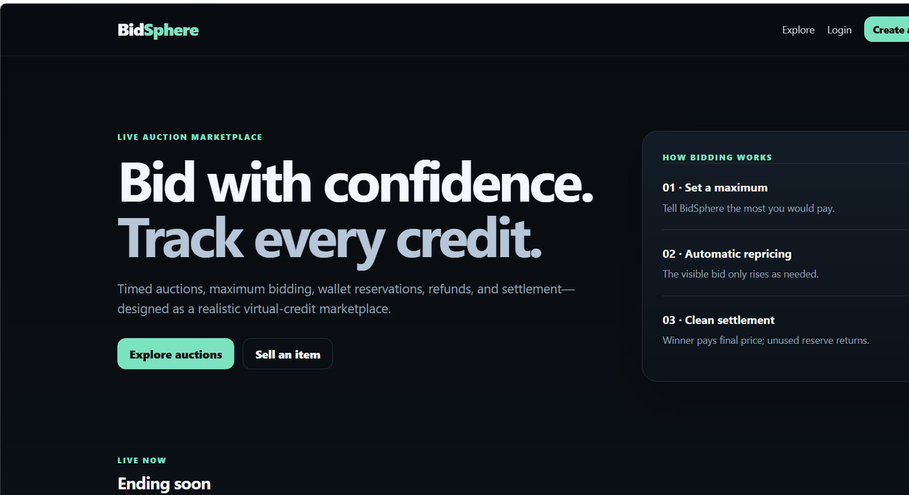
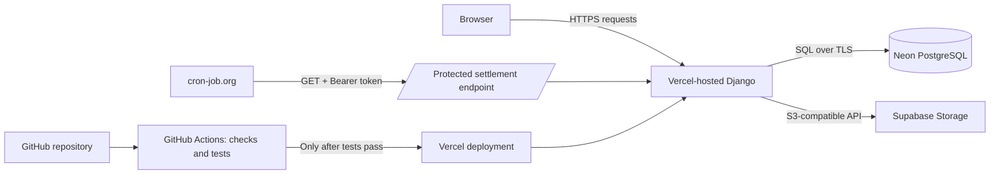
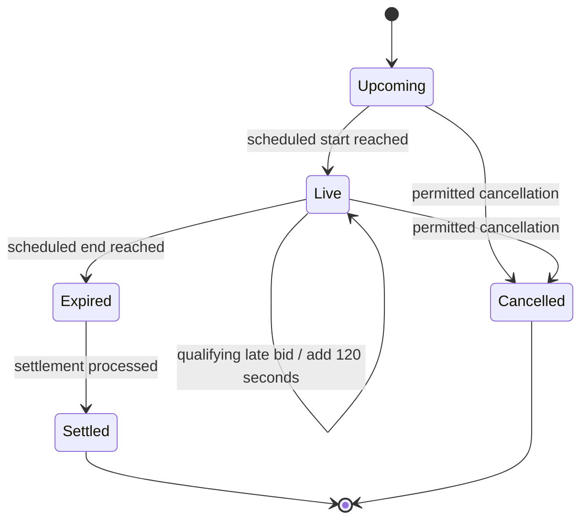

<div align="center">

# BidSphere

### A timed auction marketplace with proxy bidding and virtual-credit accounting

[](https://github.com/Siddharthsharmasj/BidSphere/actions/workflows/ci-cd.yml)


[**Live application**](https://bidsphere-eight.vercel.app/) · [Source](https://github.com/Siddharthsharmasj/BidSphere) · [Workflow runs](https://github.com/Siddharthsharmasj/BidSphere/actions)

</div>

BidSphere is a web-based auction application built with Django. Users can list items, place proxy bids, follow bidding activity, and see auctions progress from scheduled start through settlement. The application uses **virtual credits**, not real-money payments.

The interesting engineering work is in the rules behind the interface: handling competing bids, reserving and releasing credits, extending auctions when qualifying late bids arrive, and finalizing expired auctions consistently.

## At a glance

| Area | What BidSphere does |
|---|---|
| Listings | Create item listings with category, image, starting price, increment, and scheduled times |
| Proxy bidding | Let a bidder submit a maximum amount while the visible price follows the bidding rules |
| Anti-sniping | Extend an auction by 120 seconds when a qualifying bid arrives during its final 120 seconds |
| Wallet accounting | Track available virtual credits, reserved bids, released reservations, and settlement transactions |
| Auction completion | Process expired auctions through Django settlement logic, including a protected scheduled endpoint |
| Uploaded images | Store listing images in Supabase Storage through its S3-compatible interface |
| Deployment | Run Django on Vercel, use Neon PostgreSQL, and deploy through a GitHub Actions workflow after CI succeeds |

## Product preview



> The screenshot is from the deployed application. To keep this README useful, update it when the interface changes materially.

## How the system fits together



| Component | Responsibility |
|---|---|
| Django | Authentication, listing views, bidding rules, wallet operations, and settlement behavior |
| Neon PostgreSQL | Persistent auctions, bids, user-related records, and wallet transaction data |
| Supabase Storage | Persistent uploaded images; listing images intended for public viewing are served from a public bucket |
| Vercel | Hosts the deployed web application |
| GitHub Actions | Runs Django and dependency checks; deploys after the test job succeeds when deployment is enabled |
| cron-job.org | Calls the protected expired-auction endpoint on a recurring schedule |

## Auction lifecycle



The end time and settlement are separate concerns: reaching the deadline makes an auction eligible for processing; the settlement logic records its outcome. The scheduler is intended to prompt that processing even when no user is visiting the site. A recurring schedule is not a guarantee that code executes at the exact end-time second, so both the endpoint response and application records should be monitored.

## Proxy bidding and wallet accounting

A bidder submits a maximum amount. That maximum is used by the proxy-bidding logic; it is not automatically the final price. BidSphere tracks available virtual credits separately from the amount reserved for active bidding.

The expected accounting sequence is:

1. Validate that the auction is eligible for bidding and that the bid satisfies the rules.
2. Reserve the bidder's maximum amount and compute the current visible price and leader.
3. When leadership changes, release the previous leader's reservation as required by the bidding rules.
4. On settlement, record the outcome, debit the winning price according to the implemented rules, and release unused reserved credits.
5. Keep wallet movements in transaction records so changes can be audited.

### Example

Illustrative example using virtual credits and a starting price of 100 with an increment of 10:

| Event | Bidder A | Bidder B | Visible price |
|---|---:|---:|---:|
| Auction starts | — | — | 100 |
| A submits a maximum of 300 | 300 reserved | — | 100 |
| B submits a maximum of 500 and takes the lead | A's reservation is released when no longer needed | 500 reserved | 310 |
| Auction settles with B winning | — | Pays the final price; unused reservation is returned | 310 |

The values above explain the reservation model; the source code and tests define the exact tie-breaking, validation, and settlement rules. Bid placement and wallet accounting are sensitive paths: changes to them should be accompanied by regression tests, particularly for overlapping requests and repeated settlement attempts.

## Local development

### Requirements

- Python 3.12
- Git
- Dependencies listed in `requirements.txt`
- A local database configuration suitable for development

### Windows PowerShell

```powershell
git clone https://github.com/Siddharthsharmasj/BidSphere.git
cd BidSphere
py -3.12 -m venv .venv
.\.venv\Scripts\python.exe -m pip install --upgrade pip
.\.venv\Scripts\python.exe -m pip install -r requirements.txt
```

Review `.env.example` and configure local-only values supported by the project. Do not copy production secrets into a development environment. If PowerShell blocks activation scripts, use the `.venv\Scripts\python.exe` commands directly; changing the machine-wide execution policy is not required for these commands.

Apply migrations and create an administrator account:

```powershell
.\.venv\Scripts\python.exe manage.py migrate
.\.venv\Scripts\python.exe manage.py createsuperuser
.\.venv\Scripts\python.exe manage.py runserver
```

Open `http://127.0.0.1:8000/`.

### Useful development commands

Seed/reset a disposable local demo database:

```powershell
.\.venv\Scripts\python.exe manage.py seed_demo --reset
```

Close expired auctions manually in local development:

```powershell
.\.venv\Scripts\python.exe manage.py close_expired
```

Audit wallet records:

```powershell
.\.venv\Scripts\python.exe manage.py audit_wallets
```

**Never run `seed_demo --reset` against production.** It is a development/demo operation and can reset data.

## Tests and continuous delivery

The workflow is defined in [`.github/workflows/ci-cd.yml`](.github/workflows/ci-cd.yml). Its test job uses a PostgreSQL 16 service and currently runs:

- Dependency installation and `pip check`
- Project structure and syntax validation
- Django configuration and deployment-security checks
- Static asset collection
- Migration consistency checks (`makemigrations --check --dry-run`)
- Django tests against PostgreSQL
- Python dependency auditing with `pip-audit`

When the repository variable `ENABLE_VERCEL_DEPLOY` is set to `true`, deployment jobs are gated on the test job passing. Production deployment is triggered by pushes to `main`; the preview job is limited to pull requests from the same repository. The workflow sends source to Vercel for its remote build.

[View recent workflow runs](https://github.com/Siddharthsharmasj/BidSphere/actions).

## API reference

The current project documentation identifies these routes. Check the URL and view definitions before relying on them as a versioned public API.

| Method | Route | Purpose |
|---|---|---|
| `GET` | `/api/auctions/` | List auctions |
| `GET` | `/api/auctions/<id>/` | Retrieve an auction |
| `GET` | `/api/auctions/<id>/bids/` | Retrieve bid history |
| `POST` | `/api/auctions/<id>/bid/` | Submit a maximum bid; requires an authenticated session |

Example bid body:

```json
{
  "max_amount": 25000
}
```

The bid endpoint's accepted fields, validation errors, and response format are defined by the current implementation; treat this section as an orientation rather than a complete API specification.

## Scheduled settlement

The configured scheduler calls the protected route:

```http
GET /internal/cron/close-expired/
Authorization: Bearer <CRON_SECRET>
```

The route returns a JSON summary such as `checked`, `settled`, and `failed`. Monitor the HTTP status **and** the response body: an HTTP `200` does not by itself prove that every eligible auction settled successfully. Keep `CRON_SECRET` in Vercel's environment settings and the scheduler's private header configuration; never place it in the URL, README, or source code.

## Configuration reference

Production values belong in the hosting provider's environment-variable settings, not in the repository.

| Variable | Purpose |
|---|---|
| `DJANGO_SECRET_KEY` | Django signing and security secret |
| `DJANGO_DEBUG` | Debug mode; disable in production |
| `DATABASE_URL` | PostgreSQL connection string |
| `CRON_SECRET` | Bearer token for the settlement endpoint |
| `DJANGO_SECURE_HSTS_SECONDS` | HSTS duration |
| `AWS_STORAGE_BUCKET_NAME` | Supabase bucket name (`bidsphere-media`) |
| `AWS_ACCESS_KEY_ID` / `AWS_SECRET_ACCESS_KEY` | Server-side S3-compatible storage credentials |
| `AWS_S3_ENDPOINT_URL` / `AWS_S3_REGION_NAME` | Supabase S3-compatible endpoint and region |
| `AWS_S3_CUSTOM_DOMAIN` | Public base URL used to serve public bucket images |

Only store public-facing images in the public bucket. Do not use public object storage for private documents or secrets.

## Security and operational notes

- BidSphere uses virtual credits; it does not process real-money payments.
- Never commit `.env`, `.env.local`, `.vercel`, database URLs, Vercel tokens, storage credentials, or Django/cron secrets.
- Use separate development and production credentials. Rotate any value that may have been exposed.
- Do not run demo reset commands against production.
- Test bidding, cancellation, wallet releases, settlement retries, and concurrent bid requests before inviting a broader audience.
- Review scheduler execution history and investigate non-zero settlement failures.

## Repository map

```text
.
├── auction/                  # Auction and related application logic
├── bidsphere/                # Django project settings and URL routing
├── docs/screenshots/         # README screenshots
├── .github/workflows/        # CI/CD workflow
├── .env.example              # Local environment template
├── .env.vercel.example       # Hosting environment template
├── manage.py
├── requirements.txt
├── vercel.json
└── README.md
```

## Contributing

Keep changes focused and add regression tests for changes to bidding, wallet accounting, anti-sniping, or settlement. Run the relevant tests locally, inspect the GitHub Actions result, and confirm the production behavior before treating a change as complete.
